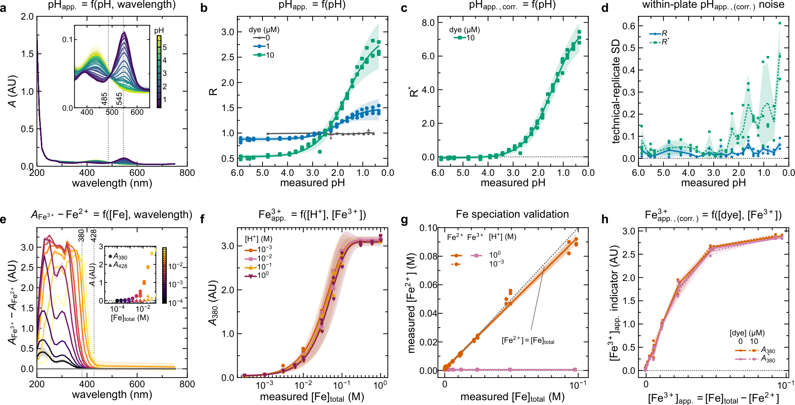
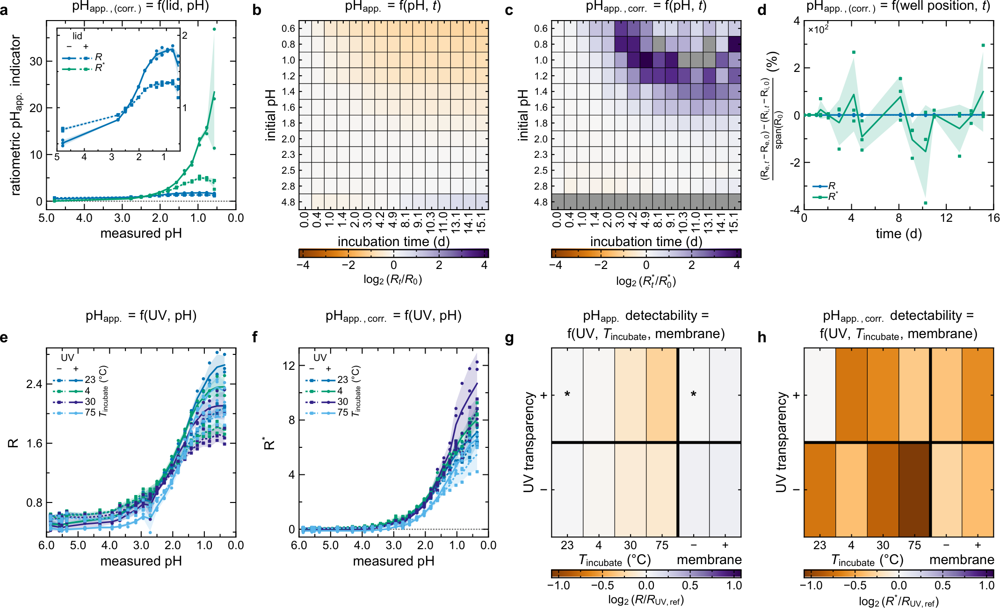
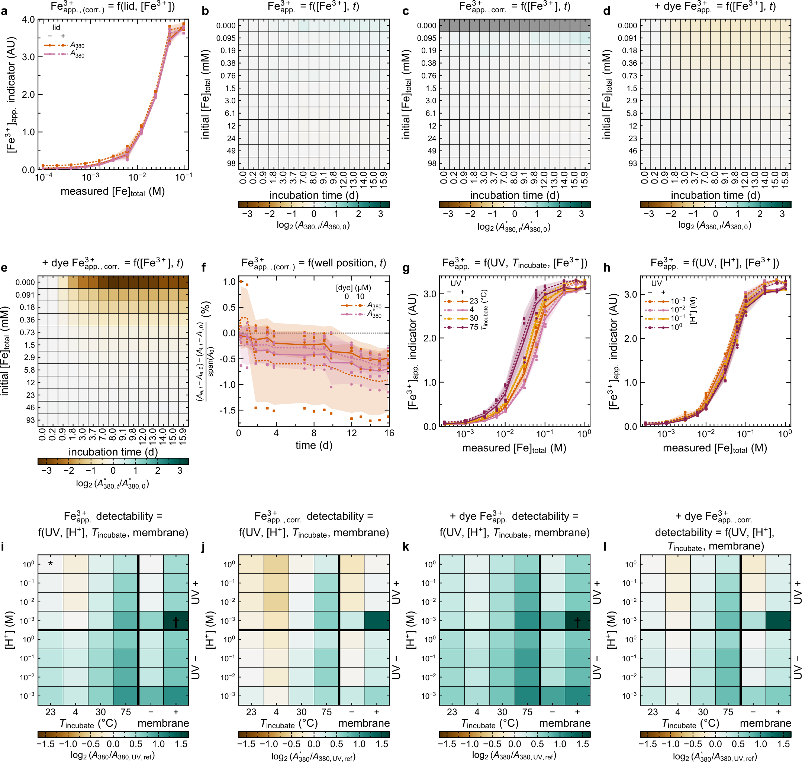
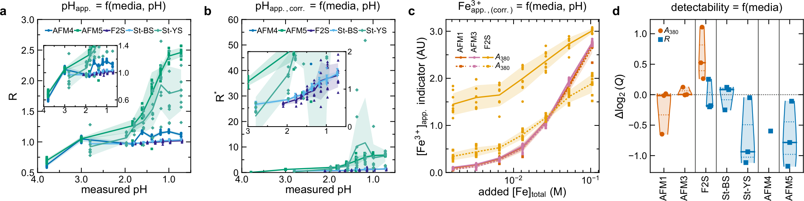
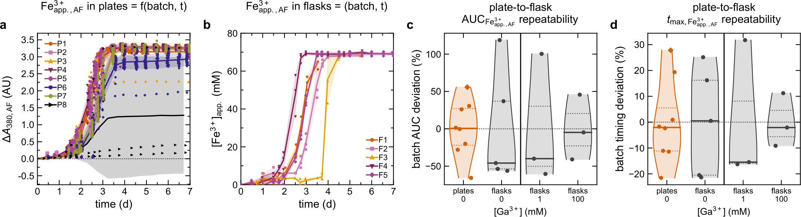
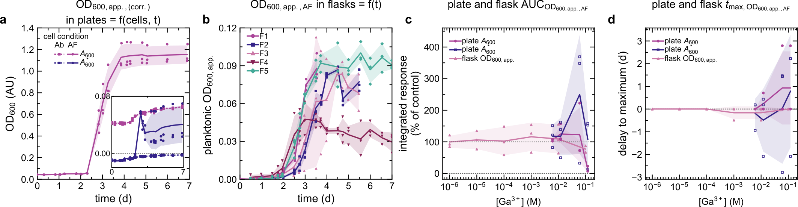
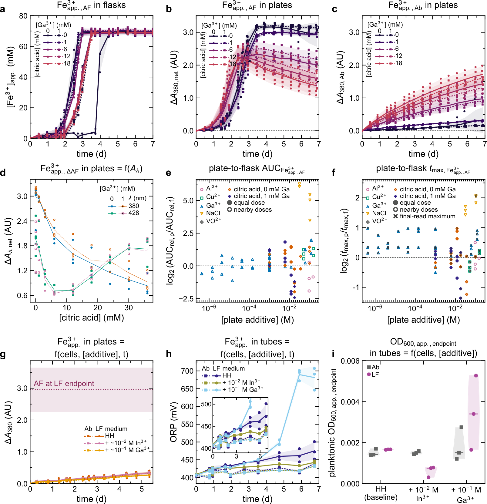
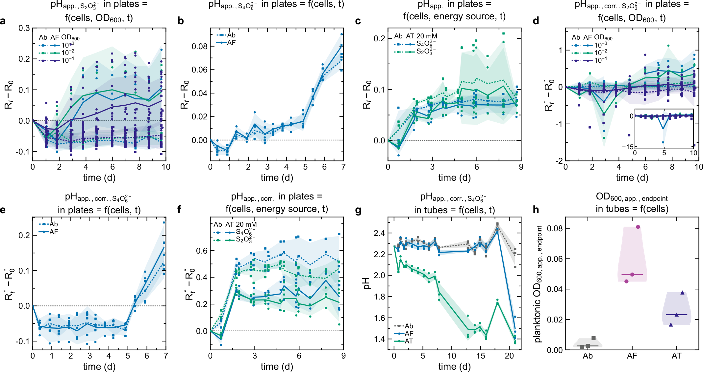

# Main figures

Eight figures cover indicator calibration, plate configurations, growth media, and plate, flask, and tube culture measurements. Each figure is available as a PNG preview and a PDF.

Plate absorbance and fluorescence-derived apparent OD600 are optical proxies; they do not establish viable biomass. AF, AT, LF, and Ab denote *Acidithiobacillus ferrooxidans*, *Acidithiobacillus thiooxidans*, *Leptospirillum ferriphilum*, and abiotic controls, respectively.

## Figure 1. Ratiometric pH and Fe³⁺ absorbance indicators in simulant solutions

[PNG](png/main_figure_01.png) · [PDF](pdf/main_figure_01.pdf)

(a) Absorbance spectra of solutions containing nominally 10 $`\mu`$M thymol blue by measured pH; the inset enlarges the indicator region, with reference lines at 485 and 545 nm. (b,c) Uncorrected $`R=A_{545}/A_{485}`$ and scatter-corrected $`R^{*}=A^{*}_{545}/A^{*}_{485}`$ as a function of measured pH, where $`A^{*}_{\lambda}=A_{\lambda}-A_{750}`$. Panel (b) compares thymol blue dosages, and (c) shows nominally 10 $`\mu`$M thymol blue. Curves are four-parameter logistic fits, except the undyed series in (b), for which lines connect means from a separate preparation cohort in non-UV-transparent plates. (d) Within-plate standard deviation of four replicate-well ratios. (e) Ferric-minus-ferrous absorbance spectra at matched total-$`\mathrm{Fe}`$ concentrations in 1 M $`\mathrm{H}_2\mathrm{SO}_4`$ without dye, using interpolation between adjacent ferrous reference concentrations. The inset shows separate endpoint measurements at 380 and 428 nm. (f) $`A_{380}`$ as a function of recorded total $`\mathrm{Fe}`$ at varied $`\mathrm{H}_2\mathrm{SO}_4`$ concentrations, with acid-specific nonlinear fits. Zero-$`\mathrm{Fe}`$ observations contribute to the fits but are absent from the logarithmic axis. (g) Titrated $`\mathrm{Fe}^{2+}`$ as a function of recorded total $`\mathrm{Fe}`$, with ordinary least-squares fits to concentration-level means and a dashed equality line. (h) $`A_{380}`$ and $`A^{*}_{380}`$ as a function of apparent $`\mathrm{Fe}^{3+}`$, calculated as total $`\mathrm{Fe}`$ minus $`\mathrm{Fe}^{2+}`$, by nominal thymol blue dosage. Dyed and undyed preparations differed in well position and volume. Points represent four-well plate means from three plates, except within-plate standard deviations in (d), individual titrations in (g), and two plates above 700 nm in (a). Unfitted lines and shaded regions indicate means and sample standard deviations; uncertainty in (e) propagates ferric and ferrous variability. Fitted shaded regions indicate 95% confidence intervals for mean responses.

## Figure 2. Ratiometric pH indicator measurements across plate configurations and incubation conditions

[PNG](png/main_figure_02.png) · [PDF](pdf/main_figure_02.pdf)

(a) Uncorrected $`R`$ and scatter-corrected $`R^{*}`$ as a function of measured pH in UV-transparent plates measured with or without a lid; the inset enlarges the lower-response region. (b,c) Changes in $`R`$ and $`R^{*}`$, respectively, during benchtop incubation in non-UV-transparent plates, expressed as $`\log_2(X_t/X_0)`$. Here $`X`$ denotes the corresponding readout, and $`X_0`$ is its initial value for the same plate and prepared pH level. Cells show mean plate-level log ratios; equal-width columns represent acquisitions labelled by mean elapsed time. (d) Edge–interior difference in change, $`100(\Delta X_e-\Delta X_i)/\mathrm{span}(X_0)`$, where $`\Delta X_e`$ and $`\Delta X_i`$ are changes from initial values in edge and interior wells. The denominator is the range of initial pH-level means, and matched-level differences receive equal weight within each plate. (e,f) $`R`$ and $`R^{*}`$, respectively, after sequential incubation at 23, 4, 30, and 75 $`^\circ`$C in UV-transparent and non-UV-transparent plates. (g,h) Changes with temperature, plate type, and gas-permeable membrane usage, expressed as $`\log_2(R/R_{\mathrm{UV,ref}})`$ and $`\log_2(R^{*}/R_{\mathrm{UV,ref}})`$. Both panels use uncorrected $`R`$ references: the initial UV-transparent measurement at 23 $`^\circ`$C for temperature comparisons and the overnight UV-transparent measurement without membrane for membrane comparisons. Asterisks in (g) identify these references. Cells average pH-level log ratios within plates and then across plates; gray cells indicate undefined values. Points represent four-well plate means in (a,e,f) and plate-level estimates in (d). Lines and shaded regions indicate means and sample standard deviations across three plates. The lid and storage experiments each used three independent standard preparations.

## Figure 3. Fe³⁺ absorbance indicator measurements across plate configurations and incubation conditions

[PNG](png/main_figure_03.png) · [PDF](pdf/main_figure_03.pdf)

(a) Uncorrected $`A_{380}`$ and $`A_{750}`$-corrected $`A^{*}_{380}`$ as a function of recorded total $`\mathrm{Fe}`$, measured with or without a lid. (b,c) Changes in $`A_{380}`$ and $`A^{*}_{380}`$, respectively, during benchtop incubation without thymol blue; (d,e) corresponding measurements with nominally 10 $`\mu`$M thymol blue. Changes are expressed as $`\log_2(X_t/X_0)`$, using the initial value for the same plate, readout, dye condition, and $`\mathrm{Fe}`$ level. Cells show mean plate-level log ratios; equal-width acquisition columns are labelled by mean elapsed time. (f) Edge–interior difference in change, $`100(\Delta X_e-\Delta X_i)/\mathrm{span}(X_0)`$, for both readouts and dye conditions. Here $`\Delta X_e`$ and $`\Delta X_i`$ denote changes from initial values in edge and interior wells; the denominator is the initial range of concentration-level means. Matched-level differences receive equal weight within each plate. (g) $`A_{380}`$ during sequential temperature incubations in 1 M $`\mathrm{H}_2\mathrm{SO}_4`$ without dye. (h) Initial $`A_{380}`$ responses by $`\mathrm{H}_2\mathrm{SO}_4`$ concentration and plate type. (i,j) Handling log ratios for $`A_{380}`$ and $`A^{*}_{380}`$ without dye; (k,l) corresponding measurements with dye. All four panels use initial uncorrected $`A_{380}`$ in UV-transparent plates without dye at 23 $`^\circ`$C in 1 M $`\mathrm{H}_2\mathrm{SO}_4`$ as the reference. References are matched by recorded total $`\mathrm{Fe}`$, with interpolation between adjacent concentrations. Cells average concentration-level log ratios within plates and then across plates. The asterisk in (i) identifies the reference configuration; daggers identify the low-acid membrane acquisition with reversed concentration ordering. Gray cells indicate undefined values. Points represent four-well plate means, except plate-level estimates in (f); lines and shaded regions indicate means and sample standard deviations across three plates.

## Figure 4. Ratiometric pH and Fe³⁺ absorbance indicators in some acidophile growth media

[PNG](png/main_figure_04.png) · [PDF](pdf/main_figure_04.pdf)

(a,b) Uncorrected $`R`$ and scatter-corrected $`R^{*}`$, respectively, as a function of pH measured before dye addition. The inset in (b) enlarges the lower-response region. (c) Uncorrected $`A_{380}`$ and $`A_{750}`$-corrected $`A^{*}_{380}`$ as a function of added total $`\mathrm{Fe}`$ in AFM1, AFM3, and F2S without dye; added $`\mathrm{Fe}`$ excludes iron already present in the media. Points in (a–c) represent individual wells; lines and shaded regions indicate means and sample standard deviations across wells from three plates. (d) Paired change in response span relative to within-level variability after scatter correction, expressed as $`\Delta\log_2(Q)=\log_2(Q_{\mathrm{corrected}}/Q_{\mathrm{raw}})`$. Here $`Q`$ is the range of reference-level means divided by the pooled within-level sample standard deviation, calculated using the same eligible wells for both readouts. Points represent plate-level estimates; violins show distributions with median and quartile marks. Three estimates are shown per medium and readout, except AFM4, for which one estimate is defined from one and three eligible wells at its two reference levels. Vertical separators group $`\mathrm{Fe}^{2+}`$ media (AFM1 and AFM3), $`\mathrm{Fe}^{2+}`$ with $`\mathrm{S}^0`$ (F2S), brown and colloidal $`\mathrm{S}^0`$ media (St-BS and St-YS), thiosulfate medium (AFM4), and tetrathionate medium (AFM5). F2S includes both pH and iron readouts.

## Figure 5. Between-batch variation in plate and flask iron readouts for A. ferrooxidans

[PNG](png/main_figure_05.png) · [PDF](pdf/main_figure_05.pdf)

(a) Initial-subtracted $`A_{380}`$ for no-additive AFM1 controls comprising 345 plates from eight starting batches (P1–P8). (b) Apparent $`\mathrm{Fe}^{3+}`$ from $`\mathrm{Fe}^{2+}`$ depletion for 15 no-additive flasks from five starting batches (F1–F5), using shared initial-medium references. Points in (a,b) represent plates or flasks; lines and shaded regions indicate within-batch means and sample standard deviations. (c,d) Between-batch percentage deviations in area under the curve (AUC) and time to the first observed maximum, respectively, calculated as $`100(x_b/\bar{x}_{\mathrm{condition}}-1)`$. Here $`x_b`$ is the within-batch vessel mean and $`\bar{x}_{\mathrm{condition}}`$ is the equally weighted mean across batches of the same condition. AUC extends from each trajectory's initial observation to its first observed maximum. Groups comprise eight no-additive plate batches, five no-additive flask batches, and three flask batches at each of 1 and 100 mM $`\mathrm{Ga}^{3+}`$. Diamonds identify the pooled starting batch containing no-additive controls from iodate experiments. Points in (c,d) represent batch estimates; violins show distributions over the observed ranges, with median and quartile marks. Points are staggered horizontally. The vertical separator distinguishes no-additive groups from Ga-treated flask groups.

## Figure 6. Plate absorbance and fluorescence-derived flask measurements for A. ferrooxidans

[PNG](png/main_figure_06.png) · [PDF](pdf/main_figure_06.pdf)

(a) Uncorrected $`A_{600}`$ and $`A_{750}`$-corrected $`A^{*}_{600}`$ for paired no-additive A. ferrooxidans (AF) and abiotic (Ab) plate conditions. The main axes show uncorrected AF absorbance; the inset shows both Ab readouts and corrected AF absorbance. The plate $`\mathrm{OD}_{600}`$ label denotes recorded absorbance. (b) Fluorescence-derived planktonic apparent $`\mathrm{OD}_{600}`$ for five no-additive flask batches, calculated per eligible TE-buffer-blank-subtracted measurement as $`\mathrm{OD}_{600,\mathrm{app.}}=(\mathrm{RFU}/74930)^{1/1.386}-0.001`$. Points in (a,b) represent plates or flasks; lines and shaded regions indicate within-batch means and sample standard deviations. (c) AUC as a percentage of the same-batch, same-readout no-Ga mean, plotted against $`\mathrm{Ga}^{3+}`$ concentration. (d) Corresponding differences between treated and mean no-Ga times to the first observed maximum. Panels (c,d) compare uncorrected plate absorbance, corrected plate absorbance, and flask apparent $`\mathrm{OD}_{600}`$. Symbols represent individual plates or flasks; lines connect equally weighted batch means at the respective recorded concentrations. Shaded regions indicate between-batch standard deviations when multiple batches are available and within-batch vessel standard deviations otherwise. The zero-dose reference is absent from the logarithmic axis.

## Figure 7. Plate and flask iron readouts and L. ferriphilum control measurements

[PNG](png/main_figure_07.png) · [PDF](pdf/main_figure_07.pdf)

(a–c) Apparent flask $`\mathrm{Fe}^{3+}`$ from $`\mathrm{Fe}^{2+}`$ depletion, net plate absorbance, and abiotic plate absorbance, respectively, for matched citric acid and $`\mathrm{Ga}^{3+}`$ formulations with A. ferrooxidans (AF). Net absorbance is the difference between initial-subtracted biotic and abiotic (Ab) responses. (d) Net endpoint absorbance at 380 and 428 nm as a function of citric acid concentration, using the same physical plates at both wavelengths. Circles and squares denote 380 and 428 nm; filled and open symbols and solid and dashed lines denote 0 and 1 mM $`\mathrm{Ga}^{3+}`$, respectively. Points represent plates, and lines connect equally weighted starting-batch means. (e,f) Plate-to-flask comparisons of control-relative AUC, $`\log_2(\mathrm{AUC}_{\mathrm{rel,p}}/\mathrm{AUC}_{\mathrm{rel,f}})`$, and mean time to the first observed maximum, $`\log_2(\bar{t}_{\max,\mathrm{p}}/\bar{t}_{\max,\mathrm{f}})`$, as a function of plate additive concentration. AUC is normalized to the same-batch no-additive control within each format. Filled and open symbols identify equal and neighboring reported doses; crosses in (f) identify maxima at the final acquisition. (g) Initial-subtracted $`A_{380}`$ for the original L. ferriphilum (LF) plate cohort and matched Ab controls. Recorded Ga and In concentrations are 142.8 and 6.22 mM; legend values are rounded. The AF reference shows the mean and between-batch standard deviation at 5.366 d, using interpolation between bracketing observations from 341 plates in eight equally weighted batches. (h) Oxidation–reduction potential for a separate fresh LF tube cohort, measured against Ag/AgCl (3 M KCl). Diamonds identify shared initial-medium references from nine measurements, three per treatment. (i) Fluorescence-derived apparent $`\mathrm{OD}_{600}`$ for three LF and three Ab tubes per treatment, using the AF-derived conversion $`\mathrm{OD}_{600,\mathrm{app.}}=(\mathrm{RFU}/74930)^{1/1.386}`$ for eligible TE-buffer-blank-subtracted measurements. In (a–c,g,h), points represent vessels and lines and shaded regions indicate means and sample standard deviations; LF plate dispersion is across technical plate replicates. Violins in (i) show individual tube measurements and median marks.

## Figure 8. Ratiometric pH readouts in soluble-sulfur plate cultures and tetrathionate tube measurements

[PNG](png/main_figure_08.png) · [PDF](pdf/main_figure_08.pdf)

(a–c) Changes from initial uncorrected ratio $`R`$ for A. ferrooxidans (AF) with thiosulfate, AF with tetrathionate, and A. thiooxidans (AT) with thiosulfate or tetrathionate, respectively. (d–f) Corresponding changes in scatter-corrected $`R^{*}`$. Prepared substrate concentrations were 20.15 mM thiosulfate for AF, 20 mM thiosulfate or tetrathionate for AT, and 5 mM tetrathionate for AF. AT panels show conditions prepared with 0.01 mM added $`\mathrm{H}_2\mathrm{SO}_4`$. Concentrations and starting-$`\mathrm{OD}_{600}`$ legend values refer to preparations before dye addition; Ab denotes abiotic controls. Points in (a–f) represent plate means; lines and shaded regions indicate means and sample standard deviations across plates. AF thiosulfate plate sets include reused starter cultures. The inset in (d) shows the full response range and corresponding means and standard deviations. The main biotic trace breaks at the acquisition at 4.794 d; the band gap near 3.78 d corresponds to one valid plate observation. (g,h) pH trajectories and fluorescence-derived endpoint apparent $`\mathrm{OD}_{600}`$, respectively, for separate tetrathionate tube cultures without added Ga, with three tubes per AF, AT, or Ab group. Initial mean trajectories use shared medium-pH references. Points in (g) represent tubes; lines and shaded regions indicate means and sample standard deviations. Endpoint values in (h) use the AF-derived conversion $`\mathrm{OD}_{600,\mathrm{app.}}=(\mathrm{RFU}/74930)^{1/1.386}`$ for eligible TE-buffer-blank-subtracted measurements; violins show individual tube measurements and median marks.

